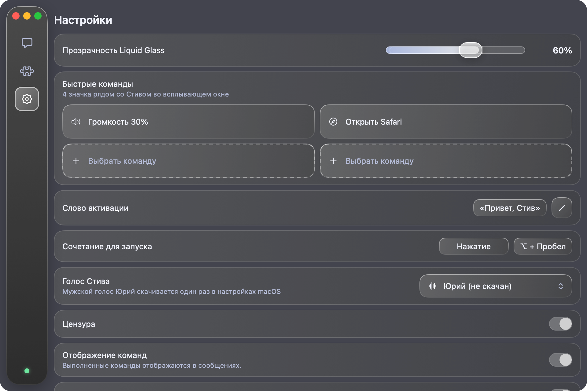

<div align="center">

# Стив

**Офлайн-помощник для Mac с пиксельным осьминогом в меню-баре.**
Говорит с вами голосом, открывает приложения, ставит таймеры и секундомер, пишет заметки, добавляет события в календарь и наводит порядок на рабочем столе.
Всё распознаётся и выполняется на вашем компьютере, без интернета.


</div>

## Что умеет Стив

| Скажите | Что произойдёт |
|---|---|
| «Открой Safari» | Откроет приложение. Работает с любым установленным приложением |
| «Таймер на 10 минут», «Запусти секундомер», «Засеки круг» | Запустит таймер или секундомер. Они показываются под Стивом с паузой и остановкой, у секундомера есть круги. По окончании таймера Стив озвучит и покажет уведомление |
| «Создай папку Работа», «Создай файл список.txt с текстом молоко», «Перемести файл список в папку Работа» | Создаст, переложит или переименует файлы и папки на рабочем столе. Файлы можно прикрепить скрепкой или перетащить в окно и сказать «Положи их в папку Работа» |
| «Отмени», «Откати», «Верни как было» | Обратит последнее действие: уберёт созданное в корзину, вернёт файл на место, прежнюю громкость, закроет открытое |
| «Запиши заметку: купить молоко» | Создаст заметку в стандартном приложении «Заметки» |
| «23 ноября с 17 до 19 событие Зал» | Добавит событие в «Календарь». Понимает «завтра в 15:30», «в понедельник в 9» и даты вроде «5 ноября» |
| «Громкость 30%», «сделай потише», «выключи звук» | Изменит системную громкость |
| «Сколько времени», «сколько заряда» | Назовёт время и уровень батареи |
| «Спасибо», «молодец» | Стив обрадуется. Радуется только на такие слова |

Команды принимаются голосом и текстом, на русском и английском.

## Как выглядит

<table>
<tr>
<td width="50%"><br><sub>Настройки: прозрачность, быстрые команды, слово активации, сочетание клавиш, голос, цензура, разрешения</sub></td>
<td width="50%"><br><sub>Пресеты: суть задачи, сценарий и фраза для запуска</sub></td>
</tr>
<tr>
<td width="50%"><br><sub>Окно из меню-бара: четыре места под быстрые команды, таймер и компактный диалог</sub></td>
<td width="50%"><br><sub>Значок в меню-баре: покой, сон, удивление, прыжок, раздумье, танец</sub></td>
</tr>
</table>

Интерфейс сделан по принципам Liquid Glass: управление плавает отдельными стеклянными плашками, без линий-разделителей. Степень прозрачности меняется ползунком в настройках.

## Особенности

- **Работает без интернета.** Речь распознаётся системным распознаванием на устройстве, озвучка идёт системным синтезатором. Ничего не отправляется наружу.
- **Живой Стив.** Моргает, смотрит по сторонам, зевает, радуется и засыпает через 5 минут без запросов. Когда вы печатаете, он следит глазами за кареткой. Статусы: «Готов», «Слушает», «Думает», «Выполняет».
- **Слово активации.** По умолчанию «Привет, Стив». Его можно поменять и «обучить» своим голосом: три записи подтверждают, что Стив вас понимает.
- **Горячая клавиша.** От 1 до 3 клавиш, режимы «нажатие» и «удерживание». По умолчанию ⌥ + Пробел.
- **Манера общения.** Короткие ответы с заглавной буквы, без восклицательных знаков и слов-паразитов. Цензура включена по умолчанию: мат заменяется на «блин». Если выключить её в настройках, Стив говорит как друг и вставляет мат к месту. Ответы каждый раз разные.
- **Свой голос.** В настройках можно выбрать системный голос, «Личный голос» из macOS или добавить запись своего голоса. Из записи Стив измеряет тон и говорит выбранным голосом с таким же тоном. Это приближение, а не клонирование голоса. Кавычки, скобки и значки разметки Стив не произносит.
- **Пресеты и быстрые команды.** Три готовых пресета (открыть Safari, громкость, папка «Привет Стив» с файлом) и свои. В окне меню-бара четыре места под значки, свободные ждут выбора.
- **История диалога** сохраняется между запусками.
- **Единое движение.** Экраны, окна и панели появляются пружинно, из размытия, как в Liquid Glass. Пока Стив думает, снизу вверх плывут три пузырька.

## Установка

Нужна macOS 14 или новее. Работает и на Маках с чипом Apple, и на Маках с Intel.

**Быстро, одной командой.** Откройте «Терминал» и вставьте:

```bash
curl -fsSL https://raw.githubusercontent.com/auurika/steve-helper/main/install.sh | bash
```

Команда скачает последнюю сборку, положит `Стив.app` в «Программы», снимет метку карантина и запустит приложение.

**Вручную.** Скачайте `Steve-macOS.zip` со страницы [Releases](https://github.com/auurika/steve-helper/releases/latest), распакуйте и перенесите `Стив.app` в «Программы». Приложение подписано «для себя», а не сертификатом Apple, поэтому macOS при первом запуске пишет, что оно повреждено или от неизвестного разработчика. Выполните один раз в «Терминале»:

```bash
xattr -dr com.apple.quarantine /Applications/Стив.app
```

Либо откройте «Системные настройки → Конфиденциальность и безопасность» и нажмите «Всё равно открыть».

**Свободный разговор** ставится из самого приложения: Настройки → «Свободный разговор» → «Установить». Стив скачает Ollama (около 190 МБ) и языковую модель (около 2,5 ГБ), один раз, с показом хода загрузки. Если Ollama и модель у вас уже есть, он возьмёт их. Команды работают и без модели. Внутри приложения модель не хранится: она слишком большая для файла приложения.

**Сборка из исходников.** Нужны Xcode 16 или новее (подойдут и Command Line Tools со Swift 6):

```bash
git clone https://github.com/auurika/steve-helper.git
cd steve-helper/app
scripts/build-app.sh
open "build/Стив.app"
```

Скрипт собирает универсальное приложение `build/Стив.app` со значком и подписью «для себя». Всё нужное лежит внутри пакета, на компьютер ничего не устанавливается.

### Разрешения

При первом запуске macOS спросит доступ. Без каждого из них Стив работает, но теряет часть умений:

| Разрешение | Зачем |
|---|---|
| Микрофон и распознавание речи | Слушать команды голосом и слово активации |
| Календарь | Добавлять события |
| Автоматизация → «Заметки» | Создавать заметки |
| Уведомления | Показывать, что таймер сработал |
| Рабочий стол | Создавать, перекладывать и переименовывать файлы и папки |
| Мониторинг ввода | Только для сочетания из одних модификаторов (например, ⌥). Сочетания с обычной клавишей разрешений не просят |

## Что пока не умеет

Честный список ограничений:

- **Свободный разговор** требует отдельной модели (около 2,7 ГБ вместе с Ollama). Приложение скачивает её само по кнопке в настройках, но не хранит внутри себя: файл приложения стал бы больше 2,5 ГБ. Без модели Стив отвечает только на команды и короткие реплики.
- **Приложение «Часы».** У него нет программного интерфейса, поэтому таймер и секундомер работают внутри Стива и показываются панелью под ним.
- **Клонирование голоса.** Нужна отдельная модель, пока только подбор тона.
- **Распознавание на английском** в режиме по умолчанию настроено на русский язык.

## Структура репозитория

```
app/                  приложение для Mac (Swift Package)
  Sources/SteveCore/    логика без интерфейса: команды, стиль, тон голоса, анимации (покрыта тестами)
  Sources/Steve/        окно, меню-бар, Стив, речь, горячая клавиша, инструменты macOS
  Tests/                37 тестов
  scripts/              сборка .app и генерация значка
mockup/               кликабельный макет интерфейса в браузере (HTML, CSS, JS без сборки)
prototype/            первый прототип на Python (только для разработки)
characters/           заготовки персонажей
docs/                 архитектура и картинки для README
```

## Разработка

```bash
cd app
swift build          # собрать
swift test           # 37 тестов логики
swift run Steve      # запустить без упаковки: микрофон, календарь и уведомления в этом режиме отключены
```

Макет открывается без сборки: `mockup/index.html` в браузере. Страница `mockup/animations.html` показывает все анимации Стива. Для проверки сна и «жизни в покое» откройте макет с параметрами `?sleep=10&idle=5` (секунды). Подробнее: [CONTRIBUTING.md](CONTRIBUTING.md).

## Благодарности

- Иконки в макете: [Lucide](https://lucide.dev), лицензия ISC. В приложении используются SF Symbols.
- Liquid Glass по руководству Apple: [Meet Liquid Glass](https://developer.apple.com/videos/play/wwdc2025/219/).

## Лицензия

[MIT](LICENSE)
